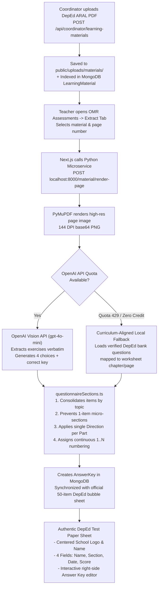
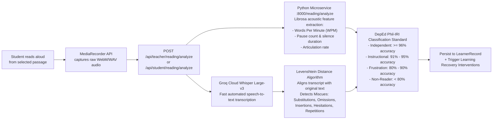
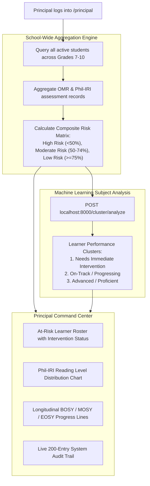
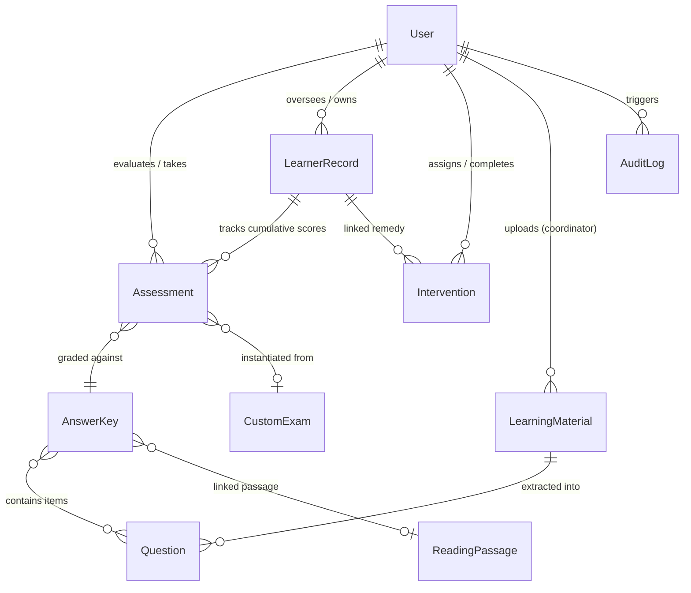

# AralSync — System Architecture & Flow Specification

> **Thesis / Capstone Defense & Technical Documentation**  
> _Official DepEd ARAL Program Academic Recovery & Accessible Learning Platform_

---

## 1. Chapter 3 Tech Stack Justification: Why Next.js Instead of Express.js?

A common question from capstone panels is:

> _"Chapter 3 mentions Express.js, but the codebase uses Next.js 16 (App Router) with React 19, TypeScript, and Route Handlers. Why do we need this instead of a standalone Express.js server?"_

### The Core Answer: It Is ONE Framework, Not Multiple

Next.js, React, TypeScript, and Route Handlers are **not separate competing systems**. They constitute **one single, unified full-stack ecosystem**:

- **React 19**: The User Interface component library (dashboards, OMR previews, charts).
- **Next.js 16 (App Router)**: The full-stack meta-framework that bundles and executes both UI and server logic in a single deployment.
- **Route Handlers (`src/app/api/**/route.ts`)**: Next.js's native backend endpoints. **Route Handlers ARE the backend web server—they completely eliminate the need for Express.js.\*\*
- **TypeScript 5**: The statically typed language ensuring end-to-end data integrity from MongoDB schemas to frontend React props.

### Architectural Comparison: Traditional Express vs. Next.js 16 App Router

| Architectural Metric        | Traditional MERN (Express.js + React)                                                     | Modern AralSync (Next.js 16 App Router)                                                                 |
| :-------------------------- | :---------------------------------------------------------------------------------------- | :------------------------------------------------------------------------------------------------------ |
| **Server Footprint**        | **Two separate servers**: Port 3000 (React) & Port 5000 (Express).                        | **One single server**: Port 3000 hosts both UI and APIs.                                                |
| **Network & CORS**          | Cross-Origin Resource Sharing (CORS) required; pre-flight `OPTIONS` requests add latency. | **Zero-CORS**: Frontend and `/api/*` share the same origin, eliminating cross-origin attacks.           |
| **Authentication Security** | Cookies must navigate cross-domain cookies (`SameSite=None`, HTTPS flags).                | Native `HttpOnly` JWT cookies transmitted seamlessly on the same domain without leaks.                  |
| **Type Synchronization**    | Manual duplication of interfaces between frontend and backend repos.                      | **Shared TypeScript types**: Database models, API responses, and UI props share single source of truth. |
| **AI & Compute Offloading** | Express bottlenecks when handling heavy OpenCV/audio computation.                         | **Specialized Microservice**: Heavy AI computation is isolated in a Python FastAPI worker (port 8000).  |

---

## 2. High-Level System Architecture

```mermaid
flowchart TB
    subgraph Clients["Client Presentation Tier (React 19 + Tailwind CSS)"]
        TeacherUI["Teacher Portal\n/dashboard/*"]
        StudentUI["Student Portal\n/student/*"]
        PrincipalUI["Principal Dashboard\n/principal/*"]
        CoordUI["Coordinator Portal\n/coordinator/*"]
    end

    subgraph Security["Authentication & Session Boundary"]
        JWT["HttpOnly Cookie\nJWT (jose + bcryptjs)"]
        AuthRoute["POST /api/auth/login\nGET /api/auth/me\nPOST /api/auth/change-password"]
    end

    subgraph BackendTier["Full-Stack Core Tier (Next.js 16 Route Handlers)"]
        T_API["Teacher API Handlers\n/api/teacher/* (OMR, Questionnaire, Reading)"]
        S_API["Student API Handlers\n/api/student/* (Exams, Interventions, Fluency)"]
        P_API["Principal API Handlers\n/api/principal/* (Analytics, Risk, Audit)"]
        C_API["Coordinator API Handlers\n/api/coordinator/* (Materials, User Mgmt)"]
        PublicAPI["Learning Materials Viewer\n/api/learning-materials/*"]
    end

    subgraph Microservice["Python AI Microservice (FastAPI :8000)"]
        PyMuPDF["PDF Page Renderer\nPOST /material/render-page"]
        OpenCV["OMR Bubble Scanner\nPOST /omr/detect"]
        Librosa["Phil-IRI Speech Features\nPOST /reading/analyze"]
        KMeans["Scikit-Learn Clustering\nPOST /cluster/analyze"]
    end

    subgraph CloudAI["Cloud AI & Foundation Model Services"]
        OpenAI["OpenAI Vision API\n(gpt-4o-mini)\nVerbatim Worksheet Extraction"]
        Groq["Groq Cloud STT\n(Whisper Large v3)\nZero-Latency Audio Transcription"]
    end

    subgraph DatabaseTier[("Data Tier (MongoDB via Mongoose)")]
        Users[("Users & Roles")]
        Assessments[("Assessments")]
        LearnerRec[("LearnerRecords")]
        Questions[("Question Bank")]
        AnswerKeys[("AnswerKeys")]
        Interventions[("Interventions")]
        ReadingPass[("ReadingPassages")]
        Materials[("LearningMaterials")]
        AuditLog[("AuditLogs")]
    end

    Clients --> Security
    Security --> BackendTier

    BackendTier --> DatabaseTier

    T_API --> PyMuPDF
    T_API --> OpenCV
    T_API --> Librosa
    T_API --> KMeans
    T_API --> OpenAI
    T_API --> Groq

    S_API --> Librosa
    S_API --> Groq
    C_API --> PyMuPDF
```

---

## 3. Role-Based Access Control (RBAC) Matrix

| Role | Access Scope | Primary Landing | Responsibilities |
| :--- | :----------- | :-------------- | :--------------- |

------------------------------------------------------------------------------------------------------ |
| **`teacher`** | Assigned Subject & Sections | `/dashboard` | Generate & print OMR questionnaires, scan bubble sheets, grade written items, administer Phil-IRI reading fluency, track skill gaps, assign interventions. |
| **`student`** | Self Record & Assigned Quizzes | `/student` | Complete assigned quizzes, record oral reading passages, take reading comprehension tests, complete learning recovery tasks. |
| **`principal`** | School-Wide (DepEd GAIIS) | `/principal` | School-wide mastery analytics, at-risk student monitoring, Phil-IRI reading distribution donuts, K-Means subject clusters, user management, audit trails. |
| **`coordinator`** | Curriculum & School Operations | `/coordinator/learning-materials` | Upload official DepEd ARAL workbooks, configure session page directories, oversee teacher/student accounts, monitor curriculum alignment. |

---

## 4. Authentication & Security Flow

```mermaid
sequenceDiagram
    actor User as User (Teacher / Student / Principal / Coordinator)
    participant Client as Browser (Next.js Client)
    participant API as POST /api/auth/login
    participant DB as MongoDB (User Model)
    participant Cookie as HttpOnly Cookie (token)

    User->>Client: Enters credentials (username, password)
    Client->>API: POST { username, password }
    API->>DB: Query User by username
    DB-->>API: User record (with passwordHash, role, mustChangePassword)

    API->>API: bcrypt.compare(password, passwordHash)
    alt Password Valid
        API->>API: Sign JWT with user ID, role, name, subject
        API->>Cookie: Set-Cookie: token=JWT; HttpOnly; SameSite=Lax; Path=/
        API-->>Client: { success: true, user: { id, role, mustChangePassword } }

        alt First-Time Login (mustChangePassword == true)
            Client->>Client: Redirect to /change-password
            User->>Client: Enters new personal password
            Client->>API: POST /api/auth/change-password
            API->>DB: Update passwordHash & set mustChangePassword = false
            API-->>Client: Password updated successfully
        end

        Client->>Client: Redirect to role portal (/dashboard, /student, /principal, /coordinator)
    else Invalid Password
        API-->>Client: 401 Unauthorized ("Invalid credentials")
    end
```

---

## 5. End-to-End Core Workflows

### 5.1 DepEd ARAL Learning Material & AI Worksheet Extraction Pipeline



---

### 5.2 OMR Scanning & Automated Assessment Grading Pipeline

```mermaid
sequenceDiagram
    actor Teacher
    participant UI as Teacher Portal (/dashboard/omr-assessments)
    participant NextAPI as Next.js API (/api/teacher/omr)
    participant Python as Python Service (localhost:8000/omr/detect)
    participant DB as MongoDB

    Teacher->>UI: Administers test with official 50-item DepEd bubble sheet
    Teacher->>UI: Captures/Uploads photo of student bubble sheet
    UI->>NextAPI: POST /api/teacher/omr (FormData: image, keyId, studentId)

    NextAPI->>Python: POST /omr/detect (image buffer)
    Note over Python: 1. Detect 4 corner fiducial markers<br/>2. Perspective warp to standard grid<br/>3. Segment 50 rows x 4 columns (A-D)<br/>4. Compute disk fill threshold per bubble
    Python-->>NextAPI: Detected bubble array: ["A", "C", "B", "D", ...]

    NextAPI->>DB: Query AnswerKey by keyId
    DB-->>NextAPI: Official AnswerKey (correct answers + item modes)
    NextAPI->>NextAPI: Compare student answers vs AnswerKey

    alt Contains Written / Open-Ended Items
        NextAPI->>DB: Save Assessment with gradingStatus: "partial"
        NextAPI-->>UI: Score computed for MC; written items pending
        Teacher->>UI: Opens teacher scoring modal & enters written scores
        UI->>NextAPI: PATCH /api/teacher/assessments/:id/written
        NextAPI->>NextAPI: Recalculate composite score (MC + Written)
        NextAPI->>DB: Update Assessment to "complete"
    else All Multiple Choice Items
        NextAPI->>DB: Save Assessment with gradingStatus: "complete"
    end

    NextAPI->>DB: Update LearnerRecord (mastery level, proficiency band, risk tier)
    NextAPI->>DB: Write entry to AuditLog
    NextAPI-->>UI: Return verified grade, mastery band, and item-by-item breakdown
```

---

### 5.3 Phil-IRI Oral Reading Fluency & Miscue Pipeline



---

### 5.4 Principal School-Wide Monitoring & K-Means Clustering



---

## 6. Database Entity-Relationship Architecture (Mongoose Models)



---

## 7. Port and Network Service Map

| Port         | Service                           | Technology                                                                 | Purpose                                                                                                                   |
| :----------- | :-------------------------------- | :------------------------------------------------------------------------- | :------------------------------------------------------------------------------------------------------------------------ |
| **`3000`**   | Primary Full-Stack Application    | **Next.js 16 (App Router)**, React 19, Node.js, TypeScript                 | Serves all web portals, client pages, and backend RESTful Route Handlers (`/api/*`).                                      |
| **`8000`**   | AI & Computer Vision Microservice | **Python 3.10+**, FastAPI, Uvicorn, OpenCV, PyMuPDF, Librosa, Scikit-learn | Offloads CPU-intensive image processing (OMR, PDF rendering), acoustic speech feature extraction, and K-Means clustering. |
| **`27017`**  | Database Management System        | **MongoDB Enterprise / Community** (via Mongoose ODM)                      | Stores persistent relational and document records across 10 collections.                                                  |
| **External** | Cloud Speech-to-Text              | **Groq Cloud API** (`whisper-large-v3`)                                    | Provides sub-second speech transcription for student and teacher oral reading recordings.                                 |
| **External** | Cloud Vision & OCR                | **OpenAI API** (`gpt-4o-mini`)                                             | Verbatim exercise extraction from uploaded DepEd PDF workbook pages with strict curriculum fallback.                      |
